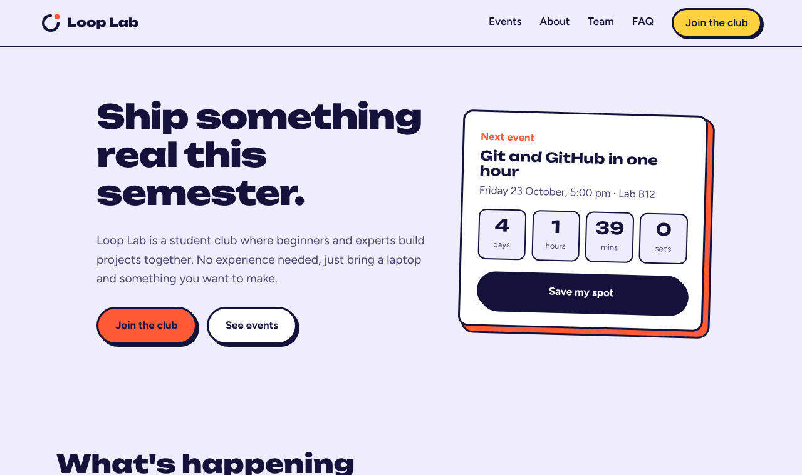
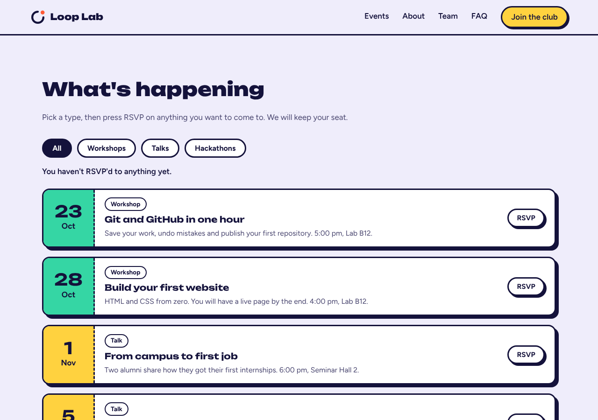
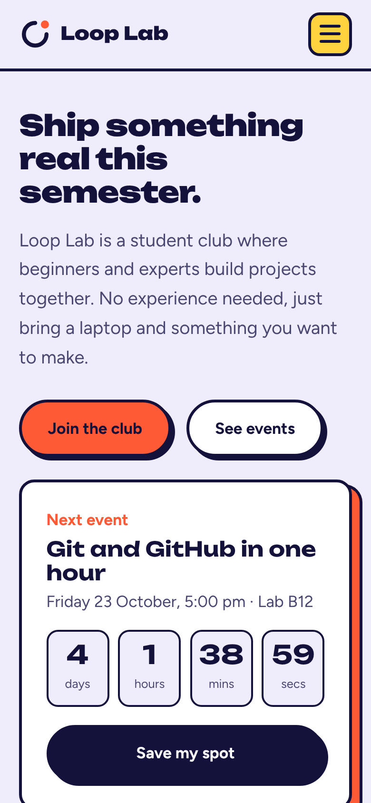

# Loop Lab: Student Coders and Makers Club

A responsive website for a fictional college coding club, built with plain HTML, CSS and JavaScript. No frameworks, no backend.

### [**View the live site**](https://kanishkar0805.github.io/loop-lab/)



| Events with filters and RSVP | On mobile |
|---|---|
|  |  |

**Live site:** https://kanishkar0805.github.io/loop-lab/
**Source code:** https://github.com/kanishkar0805/loop-lab

## The Idea

- **What it is:** the website for *Loop Lab*, a student club where beginners and experienced coders build projects together.
- **Purpose:** to let students see what the club is doing next, RSVP to events, meet the team and join in a couple of minutes, all from their phone.
- **Target audience:** first- and second-year college students who are curious about coding but are not sure where to start, plus current members who want to check the schedule.

## Features

- **Live countdown:** a ticking timer to the club's next event, shown in the hero section.
- **Event filter:** filter events by All, Workshops, Talks or Hackathons.
- **RSVP buttons:** RSVP to events and see a running count. RSVPs are remembered in the browser using `localStorage`, so they are still there after a refresh.
- **Team carousel:** a swipeable, scroll-snapping row of team cards with previous and next arrow buttons.
- **Join form:** validates the name, email and year of study, shows helpful error messages, then displays a personal membership card with a member ID. Nothing is sent anywhere.
- **FAQ accordion:** click a question to open its answer; only one is open at a time.
- **Responsive design:** works on desktop, tablet and mobile, with a hamburger navigation menu on small screens.
- **Accessibility:** skip link, visible keyboard focus, labelled buttons and form fields, and reduced-motion support.
- **Always up to date:** event dates are calculated from today's date, so the countdown never shows a past event.

## Technology Stack

- HTML5
- CSS3 (custom properties, Grid, Flexbox, scroll snap, media queries)
- JavaScript (vanilla ES6, no libraries)
- Google Fonts: Unbounded and Figtree
- Deployed with GitHub Pages

## Project Structure

```
loop-lab/
├── index.html   # page structure and content
├── style.css    # all styling and responsive rules
├── script.js    # nav, countdown, events, team, join form, FAQ
├── screenshot-*.png   # images shown in this README
└── README.md
```

## Setup Instructions

You do not need to install anything.

1. Download or clone the repository:
   ```bash
   git clone https://github.com/kanishkar0805/loop-lab.git
   cd loop-lab
   ```
2. Open `index.html` in any web browser (double-click it).
3. Optional: run a local server with `python -m http.server 8000` and visit `http://localhost:8000`.

To change the events or the team, edit the `events` and `team` lists at the top of `script.js`.

## Deployment (GitHub Pages)

1. Push the files to the `main` branch of the repository.
2. Go to **Settings → Pages**.
3. Under **Build and deployment**, set the source to **Deploy from a branch**, choose `main` and `/ (root)`, then click **Save**.
4. After about a minute, the site is live at the link at the top of this README.

## Note

Loop Lab, its events and the people shown are made up for a learning project.
